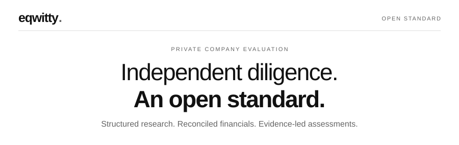
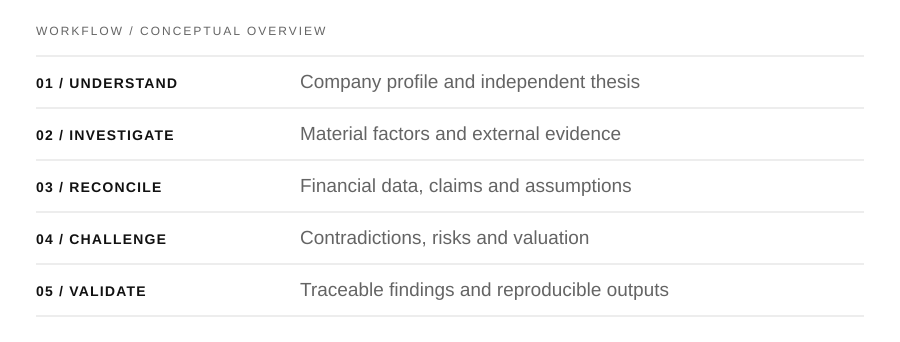

<p align="center">
  <picture>
    <source media="(prefers-color-scheme: dark)" srcset="assets/banner-dark.svg">
    <source media="(prefers-color-scheme: light)" srcset="assets/banner-light.svg">
    
  </picture>
</p>

# Eqwitty Open Diligence Standard

Open, tool-agnostic methodology and offline report generation for private companies. Maintained by [Eqwitty](https://tryeqwitty.com), distinct from the hosted platform.

[Website](https://tryeqwitty.com) · [Run an evaluation](prompts/evaluate.md) · [Evaluation protocol](evaluation-protocol.md) · [Latest release](https://github.com/jagdeepisb/tryeqwitty/releases/latest) · [Contribute](CONTRIBUTING.md)

| RELEASE | CODE | METHODOLOGY |
| :--- | :--- | :--- |
| [v2.0.0](https://github.com/jagdeepisb/tryeqwitty/releases/tag/v2.0.0) | [MIT](LICENSE) | [CC BY 4.0](NOTICE.md) |

## Start here

|  | RESOURCE |
| :--- | :--- |
| **01 / EVALUATE** | [Canonical agent prompt](prompts/evaluate.md) · [Agent instructions](AGENT.md) |
| **02 / METHODOLOGY** | [Evaluation protocol](evaluation-protocol.md) · [Detailed execution gates](methodology/execution.md) |
| **03 / REPORTS** | [Report specification](report-spec.md) · [Offline renderer and reference reports](report-kit/README.md) |
| **04 / VERIFY** | [v2.0 release profile and conformance](release/v2.0.0/README.md) · [Compatibility and migration](release/COMPATIBILITY.md) |

## From information to independent insight

<p align="center">
  <picture>
    <source media="(prefers-color-scheme: dark)" srcset="assets/workflow-dark.svg">
    <source media="(prefers-color-scheme: light)" srcset="assets/workflow-light.svg">
    
  </picture>
</p>

This is an introductory overview, not a substitute for the [canonical execution gates](methodology/execution.md). Research depth and analytical scope depend on the evaluation objective and the evidence available.

## Run an evaluation

Choose a reviewed commit or release and pin all files to it. Attach authorised company materials to an AI agent, specify the decision and give it the [canonical prompt](prompts/evaluate.md). Require actual research, evidence registers, calculation operands, qualified conclusions, challenges and missing information. Use the validator, bridge and renderer when tools permit; preserve the bundle. The kit does not itself conduct web research or guarantee factual accuracy.

## Reference reports

Explore real, fictional-company example outputs from the existing report kit. These are reference artifacts, not assessments of actual businesses.

| REFERENCE | EXISTING OUTPUTS |
| :--- | :--- |
| Complete assessment | [PDF](report-kit/reference/complete/assessment.pdf) · [HTML source](report-kit/reference/complete/assessment.html) · [Missing information](report-kit/reference/complete/missing-information.csv) |
| Sparse-evidence assessment | [PDF](report-kit/reference/sparse/assessment.pdf) · [HTML source](report-kit/reference/sparse/assessment.html) · [Missing information](report-kit/reference/sparse/missing-information.csv) |
| v2.0.0 release references | [Download all three reproducible reference reports and evidence](https://github.com/jagdeepisb/tryeqwitty/releases/download/v2.0.0/eqwitty-v2.0.0-reference.zip) · [PDF review](release/v2.0.0/PDF-REVIEW.md) |

## Technical reference

| AREA | DOCUMENTATION |
| :--- | :--- |
| Evidence and research | [Evidence rules](methodology/evidence.md) · [Research playbooks and adaptive depth](methodology/research-playbooks.md) |
| Material factors | [Factor library](factor-library/factors.json) |
| Financial analysis | [Financial guide](financial-analysis/guide.md) · [Financial model schema v1.2](schemas/financial-model-v1.2.json) |
| Valuation | [Valuation guide](valuation/guide.md) |
| Analytical contract | [Analytical bundle schema v1.4](schemas/analysis-bundle-v1.4.json) · [Validator and report bridge](analysis-kit/README.md) |
| Structured reporting | [Report specification](report-spec.md) · [Offline renderer v1.3](report-kit/README.md) |
| Benchmarks | [Synthetic benchmarks](benchmarks/README.md) · [Cross-agent acceptance rubric](benchmarks/acceptance-rubric.md) |
| Release | [Conformance profile](release/v2.0.0/README.md) · [Compatibility and migration](release/COMPATIBILITY.md) · [Change history](CHANGELOG.md) |

## Evidence and reproducibility

The v1.5 benchmark includes sealed case packets, independent reference checks and a measured fixed-evidence and live-retrieval pilot. [Benchmark methodology](benchmarks/v1.5/README.md) · [Pilot results and limitations](benchmarks/v1.5/pilot-results.md).

The v2.0.0 release publishes pinned contracts, a release manifest, checksums and reproducible reference reports. See the [release acceptance and limitations](release/v2.0.0/README.md) before interpreting the benchmark results.

## Execute a v1.4 research benchmark
```sh
python -m pip install -r report-kit/requirements.txt
python -m unittest discover -s tests
python analysis-kit/research_routing.py --stage pilot --models manufacturing --objective fundraising_readiness
python analysis-kit/validate.py benchmarks/research-pilot-manufacturing-v1.4.json
python analysis-kit/to_report.py benchmarks/research-pilot-manufacturing-v1.4.json /tmp/eqwitty-report.json
python report-kit/render.py /tmp/eqwitty-report.json --out /tmp/eqwitty-report --bundle benchmarks/research-pilot-manufacturing-v1.4.json
```
The renderer bundles its licensed fonts. Install the platform dependencies in the report kit instructions to create PDFs. Both example assessments are fictional. To use a v1.1 or v1.2 bundle with the structured renderer, pass `--report-version 1.3` to the report bridge. [Report kit](report-kit/README.md)

Recompute the stored v1.5 pilot results offline with `python analysis-kit/benchmark.py`. The pilot uses the existing v1.4 analytical contract.

## Governance and licensing

Original code is available under MIT; original methodology under CC BY 4.0. Third-party materials and brand rights are subject to the applicable notices.

[Licensing and attribution](NOTICE.md) · [Contributing](CONTRIBUTING.md) · [Governance](GOVERNANCE.md)

---

**eqwitty.** · [tryeqwitty.com](https://tryeqwitty.com)

Informational analysis, not investment advice.
